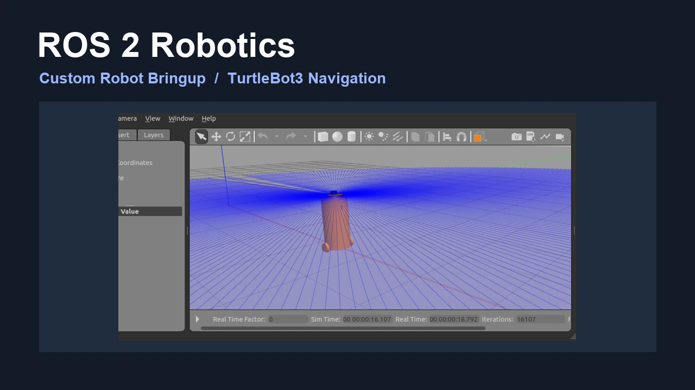

# ROS 2 Robot Simulation & Navigation

[Thumbnail](assets/thumbnail.webp) · [GitHub README](README.md) · [Architecture diagram](README.md#system-architecture)

## 中文简介

这份作品集收录两项独立的 ROS 2 课程实践。我为自定义差速机器人编写 URDF、配置相机、IMU 和 LiDAR，并编写 Gazebo Classic 与 RViz2 启动文件，调试轮关节、驱动参数和传感器安装位姿。另一项实践使用 TurtleBot3 Waffle。我通过遥控和 SLAM Toolbox 建立办公室占据栅格图，在 RViz2 采集目标位姿，修改 Nav2 示例以执行九个航点，并记录、回放导航会话。课程结果包括仿真模型、地图和一次三房间导航演示，未进行实体机器人或定量精度验证。

## English Introduction

This portfolio brings together two independent ROS 2 Mechatronics exercises. For the custom robot, I modeled a cylindrical differential-drive platform in URDF, defined its wheel joints and caster, and configured camera, IMU, and LiDAR plugins. I wrote separate launch paths for spawning the model in Gazebo Classic and inspecting its geometry and frames in RViz2. During bringup, I corrected drive settings and wheel references, then adjusted materials and sensor positions.

The navigation exercise used a TurtleBot3 Waffle in a simulated office. After early mapping passes left gaps or drift, I slowed the robot and scanned the rooms again before exporting the occupancy grid. I selected goal poses in RViz2 and adapted a Nav2 Simple Commander example with nine waypoints. I also recorded and replayed the session with rosbag2. The course record shows a route through three rooms, alongside the saved map and recorded topics. The results describe simulation behavior and do not establish physical robot performance or quantitative navigation accuracy.

## Technical Details

- **Stack** · ROS 2 Humble, URDF, Gazebo Classic, RViz2, TurtleBot3 Waffle, SLAM Toolbox, Nav2, AMCL, Python and rosbag2.
- **Contribution** · Custom model and bringup, office mapping, waypoint customization and recorded session verification.
- **Engineering challenge** · Correcting wheel and drive configuration in the custom model, and reducing drift during TurtleBot3 mapping.
- **Result** · A custom robot spawn, a saved occupancy grid and a three-room navigation run were recorded in the course. Navigation performance was evaluated qualitatively.

## Course Demonstration Videos

| Exercise | Course recording |
| --- | --- |
| Custom robot | [Gazebo bringup (MP4)](assets/demos/custom-robot-gazebo-bringup.mp4) |
| Custom robot | [RViz2 model inspection (MP4)](assets/demos/custom-robot-rviz-model-inspection.mp4) |
| TurtleBot3 | [Office waypoint navigation (MP4)](assets/demos/turtlebot3-office-waypoint-navigation.mp4) |
| TurtleBot3 | [Recorded topic playback (MP4)](assets/demos/turtlebot3-rosbag-playback.mp4) |

[Video source and timestamps](docs/video-index.md) · [Report screenshots](docs/image-index.md)
