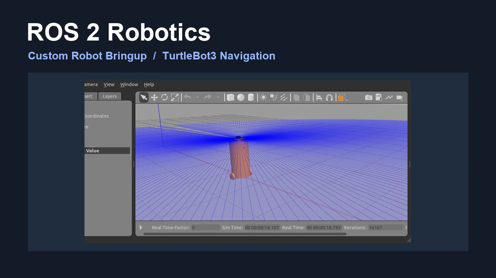
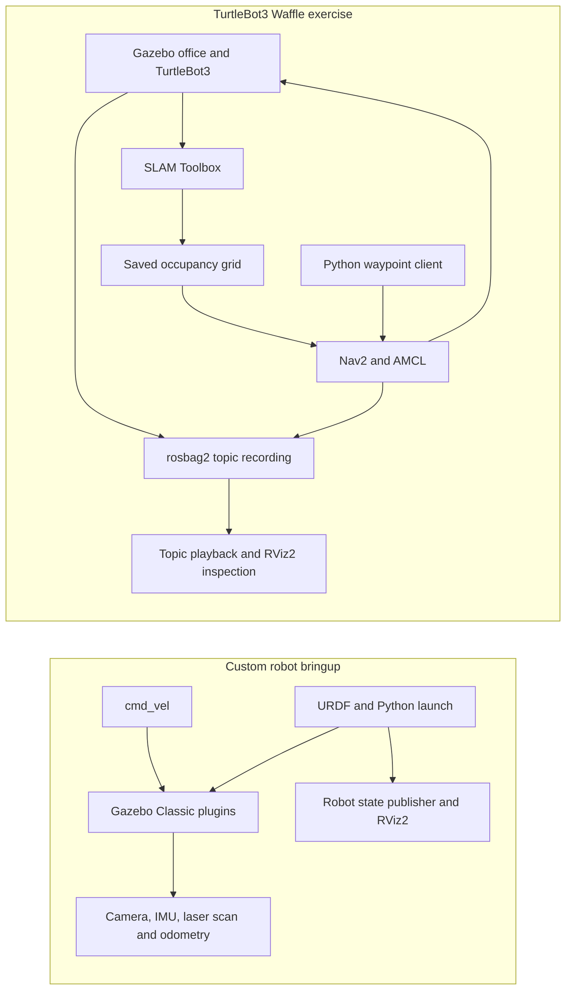

# ROS 2 Robot Simulation & Navigation

## Project Overview

Two undergraduate Mechatronics exercises. In the first, I modeled a custom differential-drive robot with sensor plugins and built a Gazebo and RViz2 bringup package. In the second, I used a TurtleBot3 Waffle to map a simulated office, navigate through waypoints and record ROS topics for replay.

## Course Demonstration Videos

These MP4 excerpts come from the original course recordings. Open a video below to view or download the recording on GitHub.

| Exercise | Course recording |
| --- | --- |
| Custom robot | [Gazebo bringup (MP4)](assets/demos/custom-robot-gazebo-bringup.mp4) |
| Custom robot | [RViz2 model inspection (MP4)](assets/demos/custom-robot-rviz-model-inspection.mp4) |
| TurtleBot3 | [Office waypoint navigation (MP4)](assets/demos/turtlebot3-office-waypoint-navigation.mp4) |
| TurtleBot3 | [Recorded topic playback (MP4)](assets/demos/turtlebot3-rosbag-playback.mp4) |

[Video source and timestamps](docs/video-index.md) · [Report screenshots](docs/image-index.md)

## My Role & Contributions

I authored the custom robot URDF, configured its wheels, caster and sensor mounts, and wrote launch files and package configuration. For TurtleBot3, I drove the mapping passes, exported the occupancy grid, recorded goal poses in RViz2 and adapted a Nav2 Simple Commander example with an initial pose and nine waypoints. I also recorded and replayed the navigation session.

## Tech Stack

| Practice | Tools |
| --- | --- |
| Custom robot | ROS 2 Humble, ament_python, Python launch, URDF, Gazebo Classic, RViz2 |
| TurtleBot3 | TurtleBot3 Waffle, Gazebo Classic, RViz2, SLAM Toolbox, Nav2, AMCL, Python and Nav2 Simple Commander |
| Session recording | rosbag2 and SQLite |

## System Architecture

## Implementation

- **Custom robot.** A cylindrical base, two wheels on continuous joints and a fixed caster form the chassis. The URDF defines sensor frames and Gazebo plugins for differential drive, camera, IMU and LiDAR. Separate launch files cover Gazebo spawning and standalone RViz2 inspection.
- **TurtleBot3.** I used teleoperation and asynchronous SLAM to build the map. I checked a single goal in RViz2, then passed nine map-frame poses to Nav2's waypoint follower. The bag preserves TF, odometry, localization, map, scan and velocity messages.

## Challenges & Solutions

The custom robot report describes correcting wheel joint references and drive parameters, adding Gazebo-compatible materials and adjusting sensor placement. Initial office mapping attempts showed gaps or drift. Slowing down and covering rooms deliberately produced the saved map, and correcting the map-saver output flag to `-f` produced the PGM/YAML pair. I then iterated on the waypoint sequence and tested playback.

## Results & Limitations

The course records show a spawned custom robot, a saved occupancy grid, a goal reached in RViz2 and a waypoint run through three rooms. Playback republishes messages, while reproducing simulated motion depends on the running nodes and simulator state. The submissions provide qualitative simulation evidence. The recordings are from the original coursework.

[Evidence map](docs/evidence-map.md) · [Image index](docs/image-index.md) · [Portfolio copy](PORTFOLIO.md) · [Credits](docs/credits.md) · [Publication checklist](PUBLISH-CHECKLIST.md)
