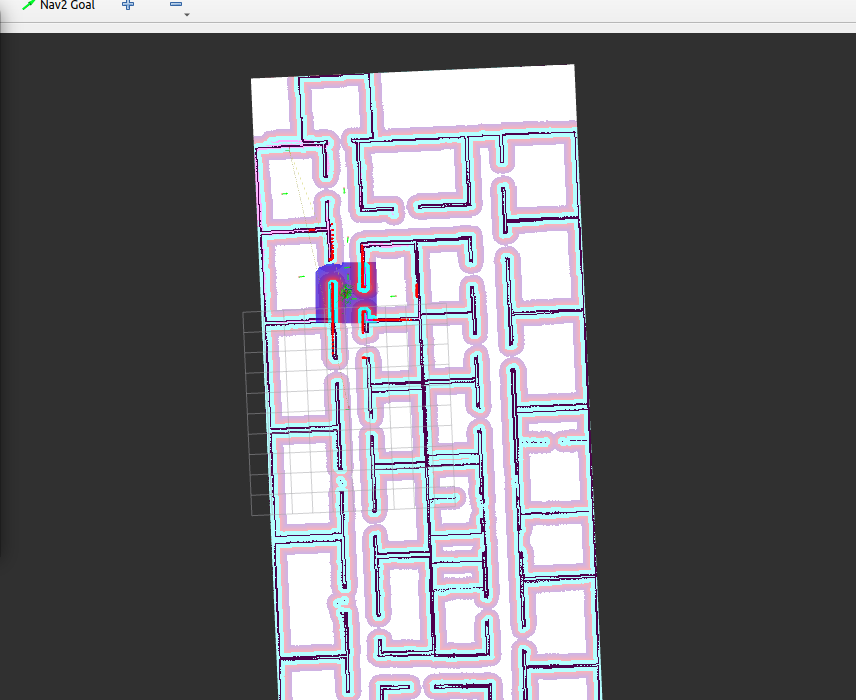

# ROS 2 Robot Simulation & Navigation

In two undergraduate ROS 2 Humble labs, I modeled a differential-drive robot and used a separate TurtleBot3 Waffle to map and navigate a simulated office.

## Screenshots & Demonstrations

| Office occupancy grid | TurtleBot3 navigation in RViz2 |
| --- | --- |
|  |  |

[Custom robot in Gazebo](assets/screenshots/custom-robot-gazebo.png) · [TurtleBot3 in the office](assets/screenshots/turtlebot3-office-gazebo.png) · [Bag replay](assets/screenshots/turtlebot3-bag-replay.png)

- **Custom robot videos** · [ROS 2 Robot Simulation](assets/demos/custom-robot-gazebo-bringup.mp4) · [RViz2 Model Inspection](assets/demos/custom-robot-rviz-model-inspection.mp4)
- **TurtleBot3 videos** · [TurtleBot3 Navigation](assets/demos/turtlebot3-office-waypoint-navigation.mp4) · [rosbag Playback](assets/demos/turtlebot3-rosbag-playback.mp4)

## Tech Stack

ROS 2 Humble · Python · URDF · Gazebo Classic · RViz2 · TurtleBot3 Waffle · SLAM Toolbox · Nav2 / AMCL · rosbag2

## Implementation

### Custom robot

I wrote the URDF for a cylindrical chassis with two drive wheels and a fixed caster. I defined frames and Gazebo plugins for a camera, an IMU, and a LiDAR, plus a differential-drive plugin for velocity commands and odometry. I wrote separate Python launch files for spawning the robot in Gazebo and inspecting the model and transforms in RViz2.

### TurtleBot3 navigation

I teleoperated the Waffle while SLAM Toolbox built an office occupancy grid, then exported the map as a PGM/YAML pair. I used RViz2 to place goals and adapted a Nav2 Simple Commander example with an office-map starting pose and nine waypoints. I used rosbag2 to record and replay transforms, scans, odometry, localization, map, and velocity messages.

## Code

- [Custom robot bringup package](custom-robot/src/curtis251_bringup) · [URDF](custom-robot/src/curtis251_bringup/urdf/curtis251_robot.urdf)
- [TurtleBot3 waypoint script](turtlebot3-navigation/follow_waypoints.py) · [Office map](turtlebot3-navigation/maps) · [Launch and navigation configuration](turtlebot3-navigation/course-config)

The office launch files depend on external course scene assets.

I adapted the [Nav2 Simple Commander waypoint example](https://github.com/ros-navigation/navigation2/blob/humble/nav2_simple_commander/nav2_simple_commander/example_waypoint_follower.py), originally copyrighted by Samsung Research America. The TurtleBot3 launch files retain their ROBOTIS and Open Source Robotics Foundation notices. [Apache 2.0 license text](turtlebot3-navigation/LICENSE-APACHE-2.0.txt)
